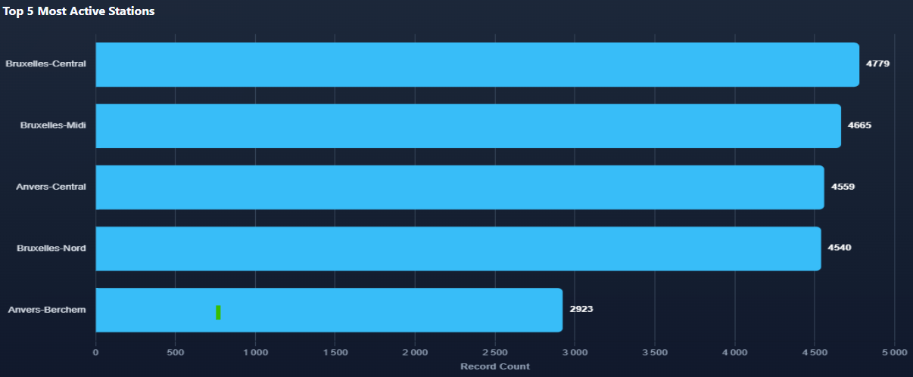
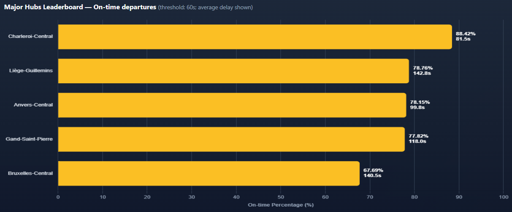
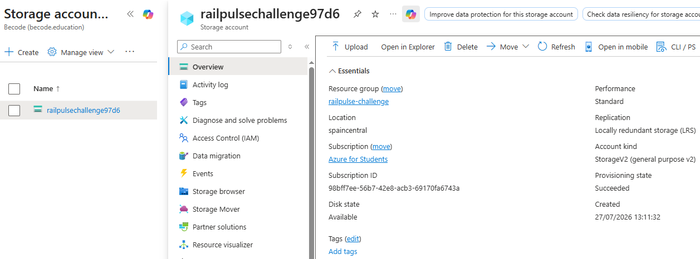
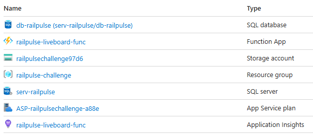
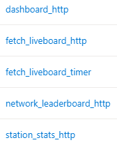
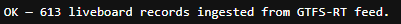
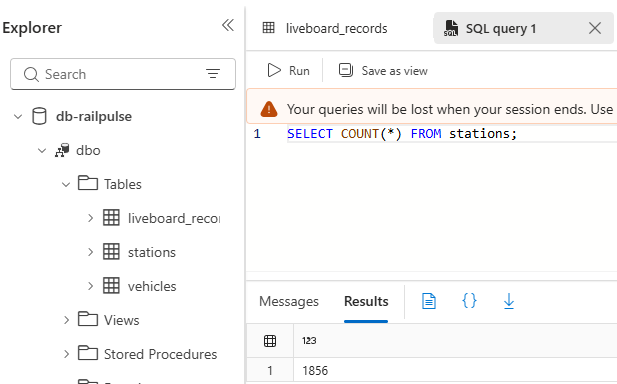

# 🚉 RailPulse Cloud — Azure Challenge

I built an automated cloud-native ETL pipeline that pulls real-time liveboard data from the SNCB/NMBS GTFS-Realtime feed, processes it in an Azure Function (serverless), and writes normalized results into an Azure SQL Database for downstream BI/dashboard use.

> **Note:** this project builds on the local SQLite/Streamlit RailPulse pipeline I put together in the previous sprint (see repo railpulse_sql_analysis), but it's a separate deliverable — I ported the ingestion logic to a cloud-native, Azure-hosted architecture (Azure Function → Azure SQL) instead of a local SQLite file.

---

## Table of contents

- [Repo structure](#repo-structure)
- [Architecture](#architecture)
- [Database schema](#database-schema)
- [Data flow / ingestion logic](#data-flow--ingestion-logic)
- [Endpoints & viewing the dashboard](#endpoints--viewing-the-dashboard)
- [Screenshots](#screenshots)
- [Environment & security](#environment--security)
- [Cost-control configuration](#cost-control-configuration-azure-for-students-100-credit)
- [Verification — actual results from Azure Portal](#verification--actual-results-from-azure-portal)
- [Conclusion](#conclusion)

---

## Repo structure

```
railpulse-challenge-azure/
├── .azurite/                       # local Azurite storage emulator data (gitignored)
├── .python_packages/                # Azure Functions remote-build dependency cache (gitignored)
├── .venv/                           # Python virtual environment (gitignored)
├── data/
│   └── stops.txt                    # GTFS static feed
├── images/                          # screenshots
│   ├── Major_Hubs_Leaderboard.png   # live on-time leaderboard chart
│   ├── Top_5_Most_Active_Stations.png  # live most-active-stations chart
│   ├── portal_resources.png         # Azure Portal, provisioned resources
│   ├── portal_count_stations.png    # Azure Portal, SQL Query Editor result
│   ├── portal_LRS.png               # Azure Portal, Storage account redundancy (LRS)
│   ├── portal_functions_list.png    # Azure Portal, deployed Functions list
│   └── api_fetch_liveboard.png      # live /api/fetch-liveboard response
├── scripts/
│   └── load_stations.py             # one-time / on-demand loader for the `stations` table
├── sql/
│   └── schema.sql                   # idempotent table + index definitions
├── .funcignore                      # excludes local-dev files from Azure Functions deployment
├── .gitignore
├── function_app.py                  # Azure Function App: HTTP + Timer triggers, serves the dashboard too
├── host.json                        # Azure Functions host configuration
├── index.html                       # static landing page pointing to the GitHub Pages demo URL
├── local.settings.json              # local-only env vars (gitignored!)
├── requirements.txt
└── station_stats_dashboard.html     # dashboard page — reads live data straight from the deployed Function App
```

I include `data/` in Git so that `stops.txt` is version-controlled and readily available (lightweight). If you clone this repo, the SNCB/NMBS GTFS static feed is already present at `data/stops.txt`, ready for running `scripts/load_stations.py`.

---

## Architecture

```
GTFS static feed (stops.txt)              SNCB/NMBS GTFS-Realtime API (JSON)
        │                                          │
        ▼                                          ▼
scripts/load_stations.py                   Azure Function App
  (one-time / on-demand)                       ├── HTTP trigger  → /api/fetch-liveboard
                │                              ├── HTTP trigger  → /api/station-stats
                │                              ├── HTTP trigger  → /api/network-leaderboard
                │                              ├── HTTP trigger  → /api/dashboard
                │                              └── Timer trigger → every 15 minutes
                ▼                                   │
                Azure SQL Database (Serverless, auto-pause 1h)
                   ├── stations
                   ├── vehicles
                   └── liveboard_records
```

---

## Database schema

Defined in `sql/schema.sql`, created idempotently (`IF NOT EXISTS`) so it can be re-run safely without breaking an existing deployment.

- **`stations`** — static reference data from `stops.txt` (`station_id` PK). `wheelchair_boarding` is nullable and empty values stay `NULL` rather than `0`, preserving "no information" vs. "not accessible".
- **`vehicles`** — one row per GTFS-RT `tripId` (PK). `vehicle_type`/`direction` are updated via `COALESCE(NULLIF(...))` on every pull so a blank incoming value never overwrites a known one.
- **`liveboard_records`** — the real-time history table. FKs to both `stations` and `vehicles`. `platform` is a placeholder (empty) — the trip-update feed doesn't expose it. `UQ_liveboard_dedup` on `(station_id, vehicle_id, scheduled_time, pulled_at)` is why each 15-minute pull inserts new rows instead of overwriting.

**Constraints & indexes**
- `UQ_liveboard_dedup`: `UNIQUE (station_id, vehicle_id, scheduled_time, pulled_at)`
- `IX_liveboard_station_time`: index on `(station_id, scheduled_time)` to speed up per-station time-range queries for the dashboard.

**Design choice — why I made `pulled_at` part of the unique key:** I wanted each 15-minute pull to insert *new* rows rather than overwrite the previous state. `liveboard_records` accumulates a full history of delay observations over time — I need that history for the dashboard, not just the latest snapshot. 

---

## Data flow / ingestion logic

**1. Station loading (`scripts/load_stations.py`)**
Reads `data/stops.txt` (the full GTFS static feed) and upserts every stop into `stations` via `MERGE` (update on existing `station_id`, insert otherwise). I run it manually, or re-run it any time the static feed is refreshed:
```bash
python scripts/load_stations.py data/stops.txt
```

**2. Live ingestion (`function_app.py`)**
`fetch_gtfs_rt_feed()` pulls the SNCB GTFS-Realtime **trip-update** feed. For each `tripUpdate`, I upsert the vehicle into `vehicles`, check each stop's normalized `stopId` against the known stations, then extract the departure time and delay, and insert into `liveboard_records`. 

**3. Serving the dashboard from the same app (`dashboard_http`)**
I added a `/api/dashboard` route that reads `station_stats_dashboard.html` off disk and returns it directly as `text/html` — a convenient way to view it without hosting the file anywhere else.

---

## Endpoints & viewing the dashboard

| Trigger | Route | Behavior |
|---|---|---|
| HTTP (anonymous) | `GET /api/fetch-liveboard` | Runs one ingestion pass on demand, returns `OK — N liveboard records ingested from GTFS-RT feed.` |
| HTTP (anonymous) | `GET /api/station-stats` | Returns the top-5 most active stations as JSON. |
| HTTP (anonymous) | `GET /api/network-leaderboard` | Returns on-time % (and average delay) for five major hubs: Bruxelles-Central, Anvers-Central, Gand-Saint-Pierre, Charleroi-Central, Liège-Guillemins. |
| HTTP (anonymous) | `GET /api/dashboard` | Serves `station_stats_dashboard.html` directly from the Function App. |
| Timer | `0 */15 * * * *` | Runs the ingestion pass automatically every 15 minutes. |

`station_stats_dashboard.html` calls the API via its **absolute** Azure URL, so it works identically no matter where it's opened from — both charts poll live every 30 seconds.

- 🌐 **GitHub Pages (Live Demo):** [https://siegried81.github.io/railpulse-challenge-azure](https://siegried81.github.io/railpulse-challenge-azure)
- ⚡ **Azure Function (API Dashboard):** [https://railpulse-liveboard-func-flex311.azurewebsites.net/api/dashboard](https://railpulse-liveboard-func-flex311.azurewebsites.net/api/dashboard)
- 💻 **Local:** run `python -m http.server 8000` from the repo root, then open `http://localhost:8000/station_stats_dashboard.html`

---

## Screenshots

Both charts below update live every 30 seconds on the actual dashboard — these are just point-in-time captures for the README.

**Top 5 Most Active Stations** (`/api/station-stats`)



**Major Hubs Leaderboard — on-time %** (`/api/network-leaderboard`)



---

## Environment & security

- I read `SQL_CONNECTION_STRING` via `os.environ` — I never hardcode it, in either `function_app.py` or `scripts/load_stations.py`. I configure it in the Function App's **Application Settings** (portal) / `local.settings.json` (gitignored) / a local PowerShell `$env:` variable when I run the loader script.
- Azure SQL firewall: I allowed my local machine's IP and enabled **"Allow Azure services and resources to access this server"** so the Function App can reach the DB.
- All HTTP routes are currently `AuthLevel.ANONYMOUS` with `Access-Control-Allow-Origin: *` — fine for moving fast during the challenge, not something I'd leave open in a production deployment.

---

## Bugs encountered & fixes

A few issues came up while building this and are worth documenting rather than glossing over:

- **CORS blocked the dashboard from calling the API.** The dashboard (`station_stats_dashboard.html`) is served from a different origin (domain) than the Function App (GitHub Pages, or a local `python -m http.server`) so browser cross-origin requests to `/api/station-stats` and `/api/network-leaderboard` were blocked by default. Fixed by explicitly returning `Access-Control-Allow-Origin: *` on those HTTP-triggered functions.
- **Blank values silently overwriting good data.** Early on, re-ingesting `vehicles` on every pull could overwrite a previously known `vehicle_type` or `direction` with an empty string whenever a later feed pull didn't include that field. Fixed with `COALESCE(NULLIF(...))` on upsert, so an empty incoming value never clobbers an existing real value.
- **Duplicate rows within a single feed pull.** GTFS-RT occasionally repeats the same `(station_id, vehicle_id, scheduled_time)` combination inside one `stopTimeUpdate` batch, which violated `UQ_liveboard_dedup` and would otherwise crash the ingestion run. Fixed by catching the conflict, logging a warning, and issuing `conn.rollback()` so the rest of the batch still inserts.
- **Unnecessary per-row DB lookups.** Originally, checking whether a stop belonged to a known station meant one `SELECT` per `stopTimeUpdate`, which doesn't scale. Fixed by loading all known `station_id`s into a Python `set` once per run (`load_known_station_ids()`) and checking membership in memory instead.

---

## Cost-control configuration (Azure for Students, $100 credit)

| Resource | Setting |
|---|---|
| Resource Group | Single dedicated group for the whole challenge |
| Azure SQL Database | Serverless compute, **auto-pause after 1 hour** |
| Function App | Flex Consumption (serverless) hosting plan |
| Storage Account | Locally Redundant Storage (LRS) |



---

## Verification — actual results from Azure Portal

**Resources provisioned** (Resource Group `railpulse-challenge`): SQL server `serv-railpulse`, SQL database `db-railpulse`, Function App `railpulse-liveboard-func` (Flex Consumption plan `ASP-railpulsechallenge-a88e`), Storage account `railpulsechallenge97d6`, and Application Insights `railpulse-liveboard-func`.



**Functions deployed** — all 5 triggers (HTTP + Timer) showing up correctly in the Function App:



**Live ingestion endpoint check** — hitting `/api/fetch-liveboard` directly in the browser:



→ `OK — 613 records ingested`, confirming the ingestion pipeline runs end-to-end on the deployed Function App, not just locally.

**SQL query checks** — run directly in the Azure SQL Query Editor:

```sql
SELECT COUNT(*) FROM stations;
```
→ **1,856 stations** loaded from the full GTFS static `stops.txt` — confirms the pipeline covers the entire SNCB network, not just a handful of hubs.



```sql
SELECT TOP 5 * FROM liveboard_records ORDER BY pulled_at DESC;
```
→ Rows accumulating steadily, with delays ranging across different stations and pull timestamps — confirming the timer trigger runs automatically every 15 minutes and history accumulates correctly.

---

## Conclusion

This challenge rebuilds my local SQLite/Streamlit RailPulse pipeline as a cloud-native ETL: an Azure Function ingesting the SNCB GTFS-Realtime feed every 15 minutes into a normalized Azure SQL schema, ready for a BI tool to plug into.

`stations`, `vehicles`, and `liveboard_records` already hold over 1,856 stations and thousands of historical rows pulled automatically — a live, growing dataset rather than a one-off test.

**What was delivered vs. what was asked**

*Must-Have:* fully met — serverless Azure SQL with firewall configured, normalized schema (`stations`, `vehicles`, `liveboard_records`) with FK relationships, a Python Function App with an HTTP-triggered ingestion endpoint, and `SQL_CONNECTION_STRING` read exclusively via `os.environ`. Goes further than asked: ingestion covers the entire SNCB network (1,856 stations) rather than a single hub.

*Nice-to-Have:* also fully met — a Timer trigger automates ingestion every 15 minutes; idempotency is handled via a `UNIQUE` constraint plus a caught-and-skipped rollback rather than a naive check-then-insert; multi-hub coverage is exceeded by full-network ingestion.